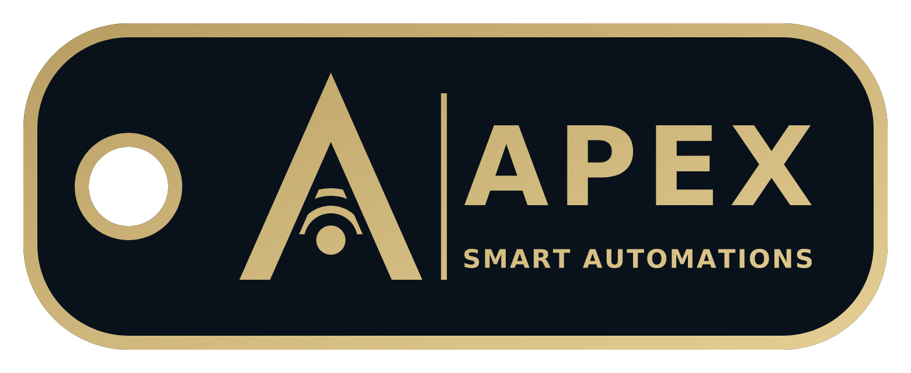

# Apex Smart Automations keychain



A 74 × 28 × 4 mm branded tag in the site's navy and gold, with the Apex "A" and
signal-wave mark, the APEX wordmark, a raised border, and a key-ring hole that fits
25–30 mm split rings.

## Files

| File | Use |
| --- | --- |
| `apex-keychain.stl` | One-piece 3D print, single colour |
| `apex-keychain-base.stl` + `apex-keychain-inlay.stl` | Two-colour print: load both as parts of one object (navy base, gold artwork) |
| `apex-keychain.svg` | Full-colour artwork at true size (mm) for UV printing, acrylic, or mock-ups |
| `apex-keychain-laser.svg` | Laser file: red hairline = cut, black fill = engrave |
| `generate_keychain.py` | Rebuilds everything above |

## Printing tips

- 0.4 mm nozzle, 0.2 mm layers (0.12 mm improves the small "SMART AUTOMATIONS" text).
- Print flat, artwork facing up, no supports.
- Single-extruder two-tone: add a filament change at **3.0 mm** (top of the base).

## Changing it

Edit the parameters at the top of `generate_keychain.py` (size, thickness, hole
size, text) and rerun:

```sh
pip install manifold3d shapely fonttools
python3 generate_keychain.py
```

The text uses DejaVu Sans Bold. Set `FONT` to another `.ttf` path to change it.
